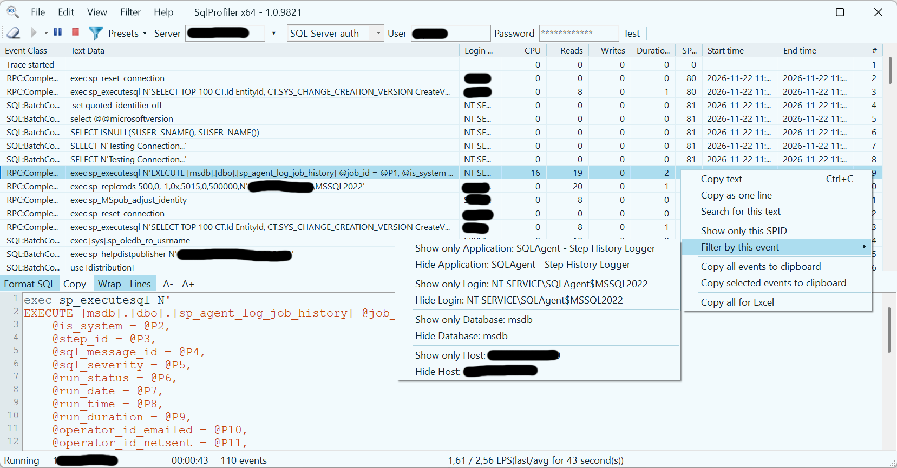

# SqlProfiler
[](https://github.com/sergiye/sqlprofiler/releases/latest)
[](https://sergiye.github.io/github-release-stats/?username=sergiye&repository=sqlprofiler&page=1&per_page=100)


*SqlProfiler is a simple and fast replacement for SQL Server Profiler with basic GUI.*

Can be used with both LocalDB, Express, Development and full-functional editions of SQL Server (2005 and later).
Distribution package contains standalone portable (can be used without installation) version of SqlProfiler.

## What does it look like?

Here's a preview of the app's UI running on Windows 10:

[](https://github.com/sergiye/sqlprofiler/raw/master/preview.png)

## Download Latest Version

The published version can be obtained from [releases](https://github.com/sergiye/sqlprofiler/releases) page, or get the newer one directly from:
[Latest Version](https://github.com/sergiye/sqlprofiler/releases/latest)

## Requirements
 * Windows with .NET Framework 4.8
 * SQL Server 2005 or later (LocalDB, Express, Developer, Standard, Enterprise)
 * A login with the `ALTER TRACE` permission on the server (membership in `sysadmin` also works)

## Features

### Tracing
 * Server-side trace created via `sp_trace_create`/`sp_trace_setevent`, events are streamed to the app with `sp_trace_getdata`
 * Windows or SQL Server authentication
 * `Encrypt connection` and `Trust server certificate` options in the File menu (the certificate is trusted by default)
 * Start, pause/resume and stop a running trace
 * "Run with filters" opens the trace properties dialog before the start
 * Selectable events:
   * `SQL:BatchStarting`, `SQL:BatchCompleted`
   * `SQL:StmtStarting`, `SQL:StmtCompleted`
   * `RPC:Starting`, `RPC:Completed`
   * `SP:StmtStarting`, `SP:StmtCompleted`
   * `Audit Login`/`Audit Logout`, `ExistingConnection`
   * `User Error Message`, `Blocked process report`
 * Selectable columns: Start time, End time, Database name, Object name, Application name, Host name (in addition to Event Class, Text Data, Login Name, CPU, Reads, Writes, Duration, SPID that are always shown)
 * Events produced by SqlProfiler itself are excluded automatically
 * Events per second statistics (last/average) in the status bar
 * The list keeps only the latest N events (5000 by default, configurable)

### Filters
 * Server-side filters applied while tracing: CPU, Reads, Writes, Duration, SPID (`=`, `<>`, `>`, `<`) and Login name, Host name, Database name, Application name, Text data (`like`/`not like`)
 * Maximum events count
 * "Filter Captured Events" applies the same filters to events that are already captured, "Clear Captured Filters" restores the full list

### Working with the captured events
 * Virtual list with thousands of events, sortable by any column (numeric columns are sorted as numbers)
 * Text data of selected events is shown in the bottom panel with T-SQL syntax highlighting; several events can be selected at once
 * Find in the "Text data" column: forward/backward search, match case, whole word, wrap around (`Ctrl+F`, `F3`); works while the trace is running (auto scroll is switched off then)
 * Select all, delete selected, keep only selected events, clear the trace window
 * Auto scroll to the latest event
 * Context menu of a row: copy text, copy as one line, search for this text (or for the text selected in the bottom panel), show only this SPID, show only/hide the application, login, database or host of the event

### Export
 * Copy all/selected events to clipboard as XML
 * Copy all events to clipboard in Excel's XML Spreadsheet format
 * Save all events to an Excel XML file

### Appearance and settings
 * `Auto`/`Light`/`Dark` themes integrated into executable, `Auto` follows the system theme
 * Custom themes from external files (see below)
 * Stay on top (`Ctrl+T`), window opacity is changed with the mouse wheel over the window
 * Window position, size, connection settings, search options and selected theme are remembered
 * Settings can be stored in a file next to the executable (portable mode) or in the user profile
 * Built-in update check (`Ctrl+U`)
 * Errors are logged to `SqlProfiler.log` next to the executable (Help - Open log file), nothing is written elsewhere

### Keyboard shortcuts
 * `F5` or `Alt+S` start/resume, `Alt+P` pause, `Shift+F5` or `Alt+T` stop trace
 * `Ctrl+F` find, `F3` find next, `Ctrl+A` select all
 * `Ctrl+C` copy the text of the selected queries (separated with `go`)
 * `Ctrl+Delete` delete selected, `Alt+Delete` keep selected, `Ctrl+Shift+Delete` clear trace window
 * `Ctrl+S` auto scroll, `Ctrl+T` stay on top
 * `Ctrl+U` check for updates, `F1` about, `Ctrl+F1` open site, `Ctrl+W` exit

## Custom themes

To add custom theme to the app, just create a `themes` folder next to the executable file and place any {themeName}.json files there.
Custom theme.json file content example:
```json
{
  "DisplayName": "Custom Theme",
  "DarkMode": true,
  "BackgroundColor": "#1E1E1E",
  "ForegroundColor": "#E9E9E9",
  "HyperlinkColor": "#00D980",
  "SelectedBackgroundColor": "#4CBB17",
  "SelectedForegroundColor": "#000000",
  "LineColor": "#262626",
  "StrongLineColor": "#454545",
  "WarnColor": "#FF4500"
}
```
Don't forget to restart the app to scan for new theme files!

## Command-line parameters
Can be used to set default GUI values.

Connection:
 * `-server`, `-s` `<server name>`
 * `-user`, `-u` `<user name>`
 * `-password`, `-p` `<user password>`
 * `-start` : automatically start profiling

Limits:
 * `-maxevents`, `-m` `<value>` : maximum events in event list (5000 by default)
 * `-duration`, `-d` `<min duration, ms>` : sets filter on duration column

Events (all of them are off by default unless selected in the trace properties):
 * `-batchcompleted`, `-batchstarting`
 * `-rpccompleted`, `-rpcstarting`
 * `-spstmtcompleted`, `-spstmtstarting`
 * `-existingconnection`, `-loginlogout`

Filters, `-<column> <condition> <value>`:
 * numeric columns `-cpu`, `-duration`, `-reads`, `-writes`, `-spid` with conditions `equal`/`eq`/`=`, `notequal`/`ne`/`!=`/`<>`, `greaterthan`/`ge`/`>`, `lessthan`/`le`/`<`
 * text columns `-databasename`, `-loginname`, `-hostname`, `-textdata`, `-applicationname` with conditions `like`/`eq`/`=`, `notlike`

Example:
```
SqlProfiler.exe -s .\sqlexpress -u sa -p secret -batchcompleted -rpccompleted -duration > 100 -applicationname like MyApp -start
```

## How can I help improve it?
The sqlprofiler team welcomes feedback and contributions!<br/>
You can check if it works properly on your PC. If you notice any inaccuracies, please send us a pull request. If you have any suggestions or improvements, don't hesitate to create an issue.

Also, don't forget to ★ star ★ the repository to help other people find it.

## Donate
If you find this project useful, consider [supporting the author](https://patreon.com/SergiyE).

## License

This program is free to use for **personal, home and other non-commercial purposes only**.

Any commercial use is not allowed without prior written permission from the author. This includes use inside a company or organization, bundling it with or into commercial products or services, and selling it or charging for access to it. For commercial licensing, please contact the author through [GitHub issues](https://github.com/sergiye/sqlprofiler/issues).

You may share unmodified copies of the program free of charge, as long as they are used under the same terms.

This program is distributed in the hope that it will be useful, but WITHOUT ANY WARRANTY; without even the implied warranty of MERCHANTABILITY or FITNESS FOR A PARTICULAR PURPOSE.

